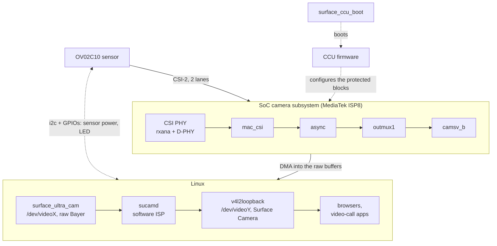

# Using the Surface Laptop Ultra camera on Linux

A set of drivers that makes the front camera of the Microsoft Surface Laptop
Ultra (NVIDIA N1X SoC, arm64) usable on Linux. The camera shows up as an
ordinary webcam called **"Surface Camera"**, so browsers and video-call apps
can use it as is.

This is an unofficial driver built through reverse engineering. It is not
affiliated with Microsoft, NVIDIA or MediaTek.

(Japanese: [README_jp.md](README_jp.md))

## Status

| Feature | Status |
|---|---|
| Front camera (OmniVision OV02C10) | **Works**: 1280x720 (default) or 1920x1080, 30 fps |
| Auto exposure / white balance / noise reduction / anti-flicker | **Works** (in software, `sucamd`) |
| Privacy LED | On only while an application is using the camera |
| Suspend / resume | Works |
| IR camera (ST VD55G1) | **Works**: **"Surface IR Camera"**, 640x480 grey, 30 fps, with the IR LED. Not at the same time as the front camera. Face authentication (as Windows Hello does) is out of scope |

Tested on kernel 7.3 (Omarchy, arm64).

## Overview



- `kernel/surface_ccu_boot.c`: powers up the camera side of the SoC and boots
  the CCU (Camera Control Unit) firmware through the SoC's Root of Trust.
- `kernel/sucam_*.c` (`surface_ultra_cam.ko`): a V4L2 capture driver for the
  sensor's raw stream. The sensor is powered only while streaming.
- `sucamd/` (Rust): turns the raw stream into ordinary webcam video and feeds
  it to v4l2loopback. It runs the camera only while someone is watching.

See [docs/how-it-works.md](docs/how-it-works.md) for the details, and
[docs/quirks.md](docs/quirks.md) for the hardware quirks and how they are
worked around.

## Requirements

- headers for the running kernel, and `dkms`
- `v4l2loopback` (e.g. the `v4l2loopback-dkms` package)
- a Rust toolchain (`cargo`) to build `sucamd`
- the CCU firmware `nvCCU.img`. **Extract it from the Windows install on your
  own machine** (it belongs to NVIDIA, so it is not included here). See
  [firmware/README.md](firmware/README.md) for the steps.

## Install

```sh
# 1. firmware (from this machine's Windows partition)
sudo ./firmware/extract-from-windows.sh
sudo install -Dm644 firmware/nvCCU.img /lib/firmware/nvidia/n1x/nvCCU.img

# 2. build sucamd and install everything (no reboot needed)
(cd sucamd && cargo build --release)
sudo ./packaging/install.sh
```

`install.sh` does the following:

- registers the kernel modules with DKMS (they are rebuilt automatically on
  kernel updates)
- installs `/etc/modprobe.d/surface-ultra-camera.conf` and
  `/etc/modules-load.d/surface-ultra-camera.conf`
- enables `sucamd.service` (front) and `sucamd-ir.service` (IR)

It is safe to run again after pulling updates. `sudo ./packaging/uninstall.sh`
removes everything.

Then just pick **"Surface Camera"** in your camera app. The IR camera is **"Surface IR Camera"**.

### About the IR camera

- It gives a grey picture lit by the IR LED, also in the dark. Exposure is the sensor's own
  auto exposure.
- The front and IR cameras share the path to camsv (outmux1 -> camsv_b), so they cannot run
  at the same time. Opening one while the other streams makes the driver return `EBUSY`;
  `sucamd-ir` / `sucamd` retry every 3 s, so it starts once the first one is closed.
- The raw device "Surface Laptop Ultra IR Camera" has V4L2 controls: `auto_exposure`
  (auto by default), `exposure`, `analogue_gain` (in manual mode) and `led_mode` (IR LED,
  `0` turns it off).
- The 600x600 picture is the centre of the sensor (804x704), cropped where the Windows
  driver crops it. No Windows capture of the IR camera exists, so the receive side (CSI
  port 2) is derived from the front camera's capture ([how-it-works.md](docs/how-it-works.md#ir-camera)).

## Options

Options for `sucamd`. Add them to `ExecStart` with `sudo systemctl edit sucamd`.

| Option | Default | |
|---|---|---|
| `--size WxH` | `1280x720` | output size, up to `1920x1080` |
| `--mains 50\|60\|auto\|off` | `auto` | mains frequency for anti-flicker; `auto` detects it from the banding |
| `--denoise 0\|1\|2` | `1` | strength of the noise reduction (temporal + chroma) |

`sucamd test <frame.raw> <out.yuyv> [options]` runs only the image processing
on a saved raw frame, which is handy for tuning.

## Troubleshooting

```sh
journalctl -u sucamd -b
journalctl -k -b | grep -iE 'surface-ccu-boot|surface-ultra-cam'
```

- `CCU firmware not running`: `surface_ccu_boot` could not boot the CCU.
  Check that the firmware is in place, and look at the `surface_ccu_boot` log.
- The raw device can be inspected directly with `v4l2-ctl`. Frames are
  1920x1080, 10-bit GBRG packed the MediaTek way (fourcc `MBGA`, 2400 bytes
  per line). `tools/raw2jpg.py` converts one to a JPEG.

## Porting / re-capturing the register tables

The register tables in `kernel/` were observed on a running Windows system with
`tools/windows-ccusnoop/` (a small, read-only Windows kernel driver). Machines
with the same SoC but a different sensor will need a new capture.

## License

GPL-2.0, see [LICENSE](LICENSE). The OV02C10 mode table comes from the
mainline Linux `ov02c10` driver.
