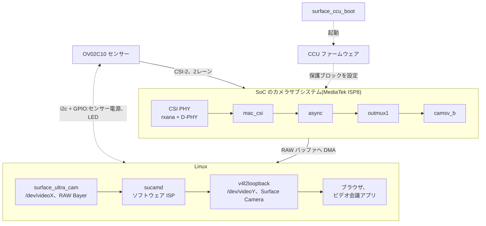

# Surface Laptop Ultra のカメラを Linux で使う

Microsoft Surface Laptop Ultra(NVIDIA N1X SoC、arm64)のフロントカメラを
Linux で使えるようにするドライバ一式です。カメラは **"Surface Camera"**
という普通のウェブカメラとして見えるので、ブラウザやビデオ会議アプリで
そのまま使えます。

リバースエンジニアリングで作った非公式のドライバです。Microsoft・NVIDIA・
MediaTek とは関係ありません。

**自己責任で使ってください。** 何の保証もありません。カメラのハードウェアを
レジスタで直接操作するドライバなので、不具合があるとシステムが固まる
ことがあります。

(英語版: [README.md](README.md))

## 対応状況

| 機能 | 状態 |
|---|---|
| フロントカメラ(OmniVision OV02C10) | **動作**:1280x720(既定)または 1920x1080、30 fps |
| 自動露出 / ホワイトバランス / ノイズ低減 / フリッカー対策 | **動作**(ソフトウェア処理、`sucamd`) |
| プライバシー LED | アプリがカメラを使っている間だけ点灯 |
| サスペンド / 復帰 | 動作 |
| IR カメラ(ST VD55G1) | **動作**:**"Surface IR Camera"** として 640x480 の白黒、30 fps、IR LED 付き。フロントカメラと同時には使えない。顔認証(Windows Hello 相当)は対象外 |

カーネル 7.3(Omarchy、arm64)で確認しています。

## 全体の構成



- `kernel/surface_ccu_boot.c`:カメラ周りの電源を入れ、SoC の Root of Trust
  経由で CCU(Camera Control Unit)のファームウェアを起動します。
- `kernel/sucam_*.c`(`surface_ultra_cam.ko`):センサーの RAW ストリームを
  扱う V4L2 キャプチャドライバ。センサーへの給電はストリーム中だけです。
- `sucamd/`(Rust):RAW ストリームを普通のウェブカメラ映像にして
  v4l2loopback に流します。誰かが見ている間だけカメラを動かします。

詳細は [docs/how-it-works_jp.md](docs/how-it-works_jp.md)、ハードウェアの癖と
その回避策は [docs/quirks_jp.md](docs/quirks_jp.md) を参照してください。

## 必要なもの

- 動作中カーネルのヘッダと `dkms`
- `v4l2loopback`(例:`v4l2loopback-dkms` パッケージ)
- `sucamd` をビルドするための Rust ツールチェーン(`cargo`)
- CCU ファームウェア `nvCCU.img`。**自分のマシンの Windows から抜き出して
  ください**(NVIDIA のものなので、ここには含めていません)。手順は
  [firmware/README_jp.md](firmware/README_jp.md)

## インストール

```sh
# 1. ファームウェア(このマシンの Windows パーティションから)
sudo ./firmware/extract-from-windows.sh
sudo install -Dm644 firmware/nvCCU.img /lib/firmware/nvidia/n1x/nvCCU.img

# 2. sucamd をビルドして全部インストール(再起動不要)
(cd sucamd && cargo build --release)
sudo ./packaging/install.sh
```

`install.sh` は次のことをします。

- カーネルモジュールを DKMS に登録する(カーネル更新時に自動で再ビルドされる)
- `/etc/modprobe.d/surface-ultra-camera.conf` と
  `/etc/modules-load.d/surface-ultra-camera.conf` を置く
- `sucamd.service`(フロント)と `sucamd-ir.service`(IR)を有効にする

更新を取り込んだあとに再実行しても大丈夫です。`sudo ./packaging/uninstall.sh` で
全部取り除けます。

あとはカメラアプリで **"Surface Camera"** を選ぶだけです。IR カメラは **"Surface IR Camera"** です。

### IR カメラについて

- 暗い所でも IR LED で照らした白黒の映像になります。露出はセンサー内蔵の自動露出です。
- フロントカメラと IR カメラは camsv までの経路(outmux1 → camsv_b)を共有しているので、
  同時には使えません。片方が映っている間にもう片方を開くと、ドライバは `EBUSY` を返し、
  `sucamd-ir` / `sucamd` は 3 秒ごとにやり直します。先に開いた方を閉じれば映ります。
- 生のデバイス "Surface Laptop Ultra IR Camera" には V4L2 コントロールがあります:
  `auto_exposure`(既定は自動)、`exposure`、`analogue_gain`(手動のとき)、
  `led_mode`(IR LED、`0` で消灯)。
- 600x600 の画像はセンサー(804x704)の中央を Windows のドライバと同じ位置で切り出したものです。
  Windows の IR カメラの通信は採取していないので、受信側(CSI ポート 2)の設定はフロントカメラの
  採取から導いたものです([how-it-works_jp.md](docs/how-it-works_jp.md#ir-カメラ))。

## オプション

`sucamd` のオプションです。`sudo systemctl edit sucamd` で `ExecStart` に追加します。

| オプション | 既定値 | |
|---|---|---|
| `--size WxH` | `1280x720` | 出力サイズ。最大 `1920x1080` |
| `--mains 50\|60\|auto\|off` | `auto` | フリッカー対策の電源周波数。`auto` は縞模様から自動判定 |
| `--denoise 0\|1\|2` | `1` | ノイズ低減(時間方向+色)の強さ |

`sucamd test <frame.raw> <out.yuyv> [オプション]` で、保存した RAW フレームに
画像処理だけを通せます。調整に便利です。

## うまく動かないとき

```sh
journalctl -u sucamd -b
journalctl -k -b | grep -iE 'surface-ccu-boot|surface-ultra-cam'
```

- `CCU firmware not running`:`surface_ccu_boot` が CCU を起動できていません。
  ファームウェアが置かれているかと、`surface_ccu_boot` のログを確認してください。
- RAW デバイスは `v4l2-ctl` で直接見られます。フレームは 1920x1080、MediaTek
  方式でパックされた 10bit GBRG(fourcc `MBGA`、1 行 2400 バイト)です。
  `tools/raw2jpg.py` で JPEG に変換できます。

## 移植 / レジスタ表の取り直し

`kernel/` のレジスタ表は、Windows の動作中に `tools/windows-ccusnoop/`
(読み取り専用の小さな Windows カーネルドライバ)で観測したものです。同じ SoC
でもセンサーが違う機種では、取り直しが必要になります。

## ライセンス

GPL-2.0。[LICENSE](LICENSE) を参照してください。OV02C10 のモード表は
mainline Linux の `ov02c10` ドライバ由来です。
