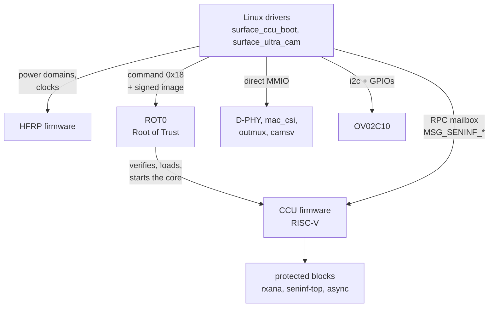

# How it works

(Japanese: [how-it-works_jp.md](how-it-works_jp.md))

The Surface Laptop Ultra's front camera is an OmniVision OV02C10, connected to
the SoC's camera subsystem over a 2-lane MIPI CSI-2 D-PHY link. The camera
subsystem is a MediaTek ISP8 (mt8991-family) design combined with NVIDIA
firmware. Some of its blocks are access-protected and can only be configured by
the CCU firmware, so the driver asks the firmware to do those parts and writes
the rest directly.

Who configures what:

## Blocks and addresses

| Block | Address | Access |
|---|---|---|
| HFRP power/clock mailbox | `0x31160000` | CPU |
| ROT0 (Root of Trust) mailbox, ACPI `NVDA8600` | `0x18010000` | CPU |
| CCU control window / RPC mailbox | `0x3C080000` | CPU |
| rxana A/B (CSI analogue receiver, port 0) | `0x12A10000`, `0x12A11000` | CCU |
| D-PHY, mac_top, mac_csi (port 0) | `0x12A12000`, `0x12A14000`, `0x12A15000` | CPU |
| seninf-top, async, TG | `0x3A300000`, `0x3A301000`, `0x3A302000` | CCU |
| outmux 0..13 | `0x3A100000 + n * 0x10000` | CPU |
| camsv_b (central part; the DMA block is at +0x1000) | `0x3A510000` | CPU |
| CAM main | `0x3A000000` | CPU |

Blocks whose access is "CCU" are firewalled from the CPU: reads return 0 and
writes are dropped.

## Power and clocks

Power domains and clocks are requested from the HFRP firmware with a 256-byte
mailbox message (doorbell `+0x100`, reply status `+0x104`, clear `+0x10c`).

- Type 1: power domain `{domain (u32), on}`. The camera needs domains 0 and 2
  (seninf) and 5 (CCU).
- Type 2: clock gates `{ids[20] (u32), [81] = on, [82] = count}`. Seninf uses
  `0xa04 0xa09 0xa0a`, the CCU `0x1a00-0x1a02 0x1a04 0x652`, CSI PHY0 `0x813`,
  and camsv `0xa04 0xa01 0xa0b 0xa10-0xa13 0xa17` plus `0xa00 0xa18` for
  camsv_b.
- Type 3: clock rate `{id, MHz}`. PHY0 is id 6 at 312 MHz.

The sensor power, reset, MCLK gate and privacy LED are five GPIOs, listed in
the `_CRS` of the ACPI node `\_SB.CAMF` (`OVTI02C1`) in the order campower,
avdd, reset (active low), mclk, pled. They are named with
`acpi_dev_add_driver_gpios()`, and `surface_ultra_cam` drives them only while
streaming.

## Booting the CCU (surface_ccu_boot)

The CCU is a RISC-V core that runs NVIDIA's signed firmware (`nvCCU.img`).
`nvCCU.img` is a container holding one image per SoC variant; this machine uses
the `mt8991` one. `surface_ccu_boot` binds to ROT0 and does the following, in
order:

1. Powers up the CCU (domains 0/2/5 and the clocks above) and initialises its
   control registers.
2. Strips the 4-byte type tag `0x000C0300` from the image and copies it into a
   physically contiguous buffer **low in DRAM** (see [quirks](quirks.md)).
3. Sends ROT0 the command `0x18 {type, size, physical address}`. ROT0 verifies
   the signature, loads the image and starts the core.
4. Waits for the CCU handshake register (`0x3C0B0020`) to reach `0xffff00a5`.

## Talking to the CCU

RPCs use a shared header at `0x3C0BC0C8` (`{w_idx, r_idx, feature, cmd, token,
len, status}`), the payload at `0x3C0BC0E4` and a doorbell at `0x3C0B00A0`.
The status reads `0x66669999` while a command is being processed and returns
the command id unchanged on success. Feature 4 is seninf (`MSG_SENINF_*`).
The commands used are:

- `0x00` set_iomem: tells the firmware where seninf-top, async and the outmuxes are
- `0x82 0x85 0x86 0x87`: seninf-top common registers; `0x80 0x89`: async
- `0xa0`: secure write to rxana (allowed ranges only); `0xa1-0xa4`: PHY setup
- `0x84 / 0x83`: outmux clock gates
- `0x01` SET_SENSOR `{sensor id, type, 0, CSI port, sel_mipi, 0}`
- `0x02` SET_STREAM `{sensor id, on}`

The exact order sent for one stream start is replayed from a capture taken on
Windows (`kernel/ccu_replay.h`).

## Stream-start sequence (surface_ultra_cam)

1. Turn on the power domains and clocks through HFRP (always first; see the
   quirks).
2. Power the sensor through the GPIOs and check its chip id (`0x300A` =
   `56 02 43`).
3. Set the outmux state (all non-waived outmuxes), then send the CCU commands
   up to SET_SENSOR: iomem, common registers, rxana/PHY, async.
4. D-PHY and mac_csi: reset the mac, write the Windows register values, and set
   CSI2_EN last.
5. Set the outmux state again, and set `SW_CFG_DONE` on each outmux to make it
   take effect.
6. camsv_b: write the Windows register values and set the per-frame DMA
   registers for TAG2/IMG2 (address, stride 2400, burst). Then enable the FBC
   with one buffer's worth of credit, set the LARB13 virtual channel, load the
   double buffer, and set `CMOS_EN` / `VFDATA_EN`.
7. Sensor: write the mode table, the frame length and the exposure/gains, and
   start streaming.
8. 40 ms later, send the remaining CCU commands: SET_SENSOR, the outmux clock
   gates and SET_STREAM. Inside SET_SENSOR the firmware picks every outmux
   whose `SRC_SEL` (`+0x18`) sensor select is below 2, assigns it to the
   sensor's CSI port, and locks the seninf-top mux and async routing.
9. Check that data reaches outmux1 (whether its debug port `+0x28` moves). If it
   does not, restart once.

The data path is OV02C10 → D-PHY → mac_csi → async → outmux1 (tag 1) →
camsv_b (TAG2, written by WDMA IMG2).

## Frame delivery

The driver does not use the camsv interrupts yet. A kernel thread polls every
1 ms:

- **SOF** (bit 6 of `SOF_STATUS 0x360` is TAG2; it clears on read): the outer
  WDMA address register has just been latched for the new frame. The buffer
  that was "pending" moves to "writing", and the next queued buffer is set up
  right away (its address plus one FBC credit with `RCNT_INC`). This gives a
  whole frame time to set up the next buffer.
- **Done**: when the FBC write count (bits 15:8 of `FBC1_TAG2 0x584`) moves,
  the "writing" buffer is returned to user space.

When no buffer is queued the FBC has no credit, so the hardware drops the frame
instead of overwriting a buffer the application is holding.

## Raw format

1920x1080 (camsv crops it from the sensor's 1928x1092), 10-bit Bayer **GBRG**.
The packing is the MediaTek one: a little-endian bitstream in which pixel *k*
of each 5-byte group occupies bits `[10k, 10k+10)`. 2400 bytes per line, black
level 64. The V4L2 fourcc is `MBGA`, the same value MediaTek's downstream ISP
driver uses for `V4L2_PIX_FMT_MTISP_SGBRG10`.

Controls: `exposure` (lines, 4..1454), `analogue_gain` (0x10..0xf8, gain x16),
`digital_gain` (0x400..0x3fff, gain x1024).

## sucamd

`sucamd` reads the raw node and writes YUYV to a v4l2loopback device. Each
frame goes through:

1. unpacking and black-level correction
2. bilinear demosaicing
3. gray-world white balance
4. scaling to the output size
5. gamma (with a mild S-curve)
6. conversion to BT.601 (with slightly stronger saturation)
7. a 3x3 blur on the chroma and a motion-adaptive temporal filter (the
   threshold follows the sensor gain)

The whole pipeline is spread over all cores with rayon and takes about 3 ms at
720p.

Auto exposure adjusts exposure (up to one frame), then analogue gain, then
digital gain, so that the mean green level is 180 (out of 959). When flicker is
detected (energy in the row means at the period of 100 Hz or 120 Hz banding,
about 438 or 365 lines), the exposure is kept a whole number of flicker
periods.

sucamd subscribes to v4l2loopback's client-usage event and runs the camera only
while some application is reading (the LED is lit only then too). It stops 2
seconds after the last reader leaves.
