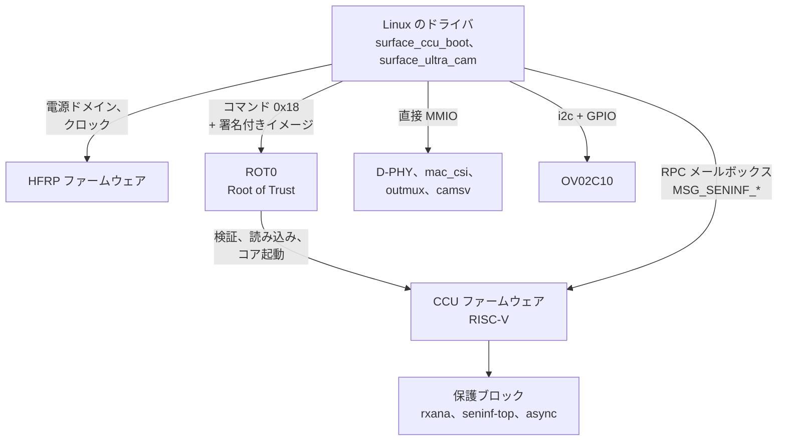

# 仕組み

(英語版: [how-it-works.md](how-it-works.md))

Surface Laptop Ultra のフロントカメラは OmniVision OV02C10 で、2 レーンの
MIPI CSI-2 D-PHY で SoC のカメラサブシステムにつながっています。カメラ
サブシステムは MediaTek ISP8(mt8991 系)の設計に NVIDIA のファームウェアを
組み合わせたものです。一部のブロックはアクセス保護されていて CCU
ファームウェアからしか設定できないため、ドライバはその部分をファームウェアに
依頼し、残りは直接書き込みます。

誰が何を設定するか:

## ブロックとアドレス

| ブロック | アドレス | アクセス |
|---|---|---|
| HFRP 電源/クロック メールボックス | `0x31160000` | CPU |
| ROT0(Root of Trust)メールボックス、ACPI `NVDA8600` | `0x18010000` | CPU |
| CCU 制御ウィンドウ / RPC メールボックス | `0x3C080000` | CPU |
| rxana A/B(CSI のアナログ受信部、ポート 0) | `0x12A10000`, `0x12A11000` | CCU |
| D-PHY、mac_top、mac_csi(ポート 0) | `0x12A12000`, `0x12A14000`, `0x12A15000` | CPU |
| seninf-top、async、TG | `0x3A300000`, `0x3A301000`, `0x3A302000` | CCU |
| outmux 0..13 | `0x3A100000 + n * 0x10000` | CPU |
| camsv_b(中央部。DMA ブロックは +0x1000) | `0x3A510000` | CPU |
| CAM main | `0x3A000000` | CPU |

アクセスが「CCU」のブロックは CPU からはファイアウォールで遮断されていて、
読むと 0、書き込みは捨てられます。

## 電源とクロック

電源ドメインとクロックは、HFRP ファームウェアに 256 バイトのメールボックス
メッセージで依頼します(ドアベル `+0x100`、応答ステータス `+0x104`、
クリア `+0x10c`)。

- タイプ 1:電源ドメイン `{domain (u32), on}`。カメラにはドメイン 0 と 2
  (seninf)、5(CCU)が必要。
- タイプ 2:クロックゲート `{ids[20] (u32), [81] = on, [82] = 個数}`。
  seninf は `0xa04 0xa09 0xa0a`、CCU は `0x1a00-0x1a02 0x1a04 0x652`、
  CSI PHY0 は `0x813`、camsv は `0xa04 0xa01 0xa0b 0xa10-0xa13 0xa17` に加えて、
  camsv_b 用の `0xa00 0xa18`。
- タイプ 3:クロック周波数 `{id, MHz}`。PHY0 は id 6 で 312 MHz。

センサーの電源・リセット・MCLK のゲート・プライバシー LED は 5 本の GPIO で、
ACPI ノード `\_SB.CAMF`(`OVTI02C1`)の `_CRS` に campower、avdd、reset
(アクティブロー)、mclk、pled の順で並んでいます。`acpi_dev_add_driver_gpios()`
で名前を付け、`surface_ultra_cam` がストリーム中だけ駆動します。

## CCU の起動(surface_ccu_boot)

CCU は RISC-V コアで、NVIDIA の署名付きファームウェア(`nvCCU.img`)で
動きます。`nvCCU.img` は SoC の種類ごとのイメージを入れたコンテナで、
このマシンでは `mt8991` 向けを使います。`surface_ccu_boot` は ROT0 に
バインドして、次の順に処理します。

1. CCU に電源を入れ(ドメイン 0/2/5 と上記のクロック)、制御レジスタを
   初期化する。
2. イメージから 4 バイトの型タグ `0x000C0300` を除き、物理的に連続した
   **DRAM の低い位置**のバッファにコピーする([癖](quirks_jp.md)を参照)。
3. ROT0 にコマンド `0x18 {type, size, 物理アドレス}` を送る。ROT0 が署名を
   検証し、イメージを読み込んでコアを起動する。
4. CCU のハンドシェイクレジスタ(`0x3C0B0020`)が `0xffff00a5` になるのを
   待つ。

## CCU とのやり取り

RPC は `0x3C0BC0C8` の共有ヘッダ(`{w_idx, r_idx, feature, cmd, token, len,
status}`)、`0x3C0BC0E4` のペイロード、`0x3C0B00A0` のドアベルで行います。
ステータスは処理中は `0x66669999` で、成功するとコマンド ID がそのまま
返ります。feature 4 が seninf(`MSG_SENINF_*`)です。使うコマンドは次の
とおりです。

- `0x00` set_iomem:seninf-top、async、outmux の場所をファームウェアに教える
- `0x82 0x85 0x86 0x87`:seninf-top の共通レジスタ、`0x80 0x89`:async
- `0xa0`:rxana へのセキュア書き込み(許可された範囲のみ)、`0xa1-0xa4`:PHY の設定
- `0x84 / 0x83`:outmux のクロックゲート
- `0x01` SET_SENSOR `{センサー ID, 種別, 0, CSI ポート, sel_mipi, 0}`
- `0x02` SET_STREAM `{センサー ID, on}`

1回のストリーム開始で送る正確な順序は、Windows で採取したものを再生して
います(`kernel/ccu_replay.h`)。

## ストリーム開始の手順(surface_ultra_cam)

1. HFRP で電源ドメインとクロックを入れる(必ず最初に。癖を参照)。
2. GPIO でセンサーに給電し、チップ ID を確認する(`0x300A` = `56 02 43`)。
3. outmux の状態を設定(waive されていない全 outmux)し、SET_SENSOR の手前
   までの CCU コマンドを送る:iomem、共通レジスタ、rxana/PHY、async。
4. D-PHY と mac_csi:mac をリセットし、Windows のレジスタ値を書き、
   最後に CSI2_EN を立てる。
5. もう一度 outmux の状態を設定し、各 outmux の `SW_CFG_DONE` を立てて
   反映させる。
6. camsv_b:Windows のレジスタ値を書き、TAG2/IMG2 のフレーム単位の DMA
   レジスタ(アドレス、ストライド 2400、バースト)を設定する。続けて FBC を
   有効にしてバッファ 1 枚分のクレジットを与え、LARB13 の仮想チャネルを
   設定し、二重バッファを読み込ませてから `CMOS_EN` / `VFDATA_EN` を立てる。
7. センサー:モード表、フレーム長、露出/ゲインを書き、ストリームを開始する。
8. 40 ms 後に残りの CCU コマンドを送る:SET_SENSOR、outmux のクロック
   ゲート、SET_STREAM。SET_SENSOR の中でファームウェアは、`SRC_SEL`
   (`+0x18`)のセンサー選択が 2 未満の outmux をすべて選んでセンサーの
   CSI ポートに割り当て、seninf-top の mux と async の経路を固定する。
9. outmux1 までデータが届いているか確認する(デバッグポート `+0x28` が動く
   かどうか)。届いていなければ一度だけやり直す。

データの経路は、OV02C10 → D-PHY → mac_csi → async → outmux1(tag 1)→
camsv_b(TAG2、WDMA IMG2 で書き込み)です。

## フレームの受け渡し

camsv_b の SOF 割り込み(ISP1 の `_CRS` にある GSI `0x20D`。Windows と同じく
`SOF_STATUS_EN 0x35C` = `0x40` で有効)で動きます。割り込みはストリーム中だけ
登録します。それ以外の時間は camsv の電源が落ちていて、読むとバスが止まるからです。
割り込みが取れないとき、またはモジュールパラメータ `poll=1` のときは、カーネル
スレッドが 1 ms ごとにポーリングします。割り込みごとに、次の順で処理します。

- **完了**:FBC の書き込みカウント(`FBC1_TAG2 0x584` の bit 15:8)が進んで
  いたら、「書き込み中」のバッファをユーザー空間に返す。フレームの書き込みは
  次の SOF より前に終わるので、SOF の時点で確認すれば足りる。
- **SOF**(`SOF_STATUS 0x360` の bit 6 が TAG2。読むとクリアされる):
  外側の WDMA アドレスレジスタが、新しいフレーム用にちょうどラッチされた
  ところ。「予約中」だったバッファを「書き込み中」に移し、次のキューの
  バッファをすぐに設定する(アドレスと、`RCNT_INC` による FBC クレジット
  1 つ)。これで次のバッファの設定に丸々 1 フレーム分の時間がある。

キューにバッファが無いときは FBC にクレジットが無いので、ハードウェアは
アプリが持っているバッファを上書きせず、そのフレームを捨てます。

## RAW フォーマット

1920x1080(camsv がセンサーの 1928x1092 から切り出す)、10bit Bayer の
**GBRG**。パック方式は MediaTek 式で、リトルエンディアンのビット列として
5 バイトごとのグループの中で画素 *k* が bit `[10k, 10k+10)` を占めます。
1 行 2400 バイト、黒レベル 64。V4L2 の fourcc は `MBGA` で、MediaTek の
ダウンストリーム ISP ドライバが `V4L2_PIX_FMT_MTISP_SGBRG10` に使っている
値と同じです。

コントロール:`exposure`(ライン数、4..1454)、`analogue_gain`
(0x10..0xf8、ゲイン x16)、`digital_gain`(0x400..0x3fff、ゲイン x1024)。

## sucamd

`sucamd` は RAW ノードを読んで、YUYV を v4l2loopback デバイスに書きます。
1 フレームごとの処理は次のとおりです。

1. 展開と黒レベル補正
2. バイリニアのデモザイク
3. グレーワールドのホワイトバランス
4. 出力サイズへの縮小
5. ガンマ(弱い S カーブ付き)
6. BT.601 への変換(彩度を少し強める)
7. 色差の 3x3 ぼかしと、動き適応の時間方向フィルタ(しきい値はセンサー
   ゲインに連動)

全工程を rayon で全コアに分散し、720p で約 3 ms です。

自動露出は緑の平均が 180(959 中)になるように、露出(最大 1 フレーム)→
アナログゲイン → デジタルゲインの順に調整します。フリッカーを検出すると
(行平均の、100 Hz または 120 Hz の縞の周期、約 438 または 365 ライン
でのエネルギー)、露出をフリッカー周期の整数倍に揃えます。

sucamd は v4l2loopback の client-usage イベントを購読していて、どれかの
アプリが読んでいる間だけカメラを動かします(LED もその間だけ点灯)。最後の
読み手がいなくなってから 2 秒後に停止します。
